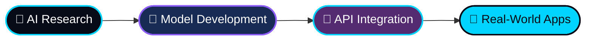

<div align="center">


<br/>

<a href="https://www.linkedin.com/in/chethan-h-s-7143762b5/"></a>
<a href="https://github.com/CHS18-77?tab=repositories"></a>


<br/><br/>

> *"I build intelligent systems that turn complex problems into practical solutions."*

</div>

<br/>

## `◈ BOOT SEQUENCE`

```python
class Engineer:
    name      = "Chethan H S"
    role      = "AI & Software Engineer"
    focus     = ["Generative AI", "LLMs & RAG", "Agentic Workflows", "Computer Vision"]
    mindset   = "Think differently. Engineer intelligently. Build with purpose."
    currently = "Shipping practical AI that actually works in the real world"

    def build(self, idea):
        return idea.research().train().integrate().deploy()   # ✔ ideas → intelligent apps
```

<br/>

## `◈ THE PIPELINE`



<br/>

## `◈ THE TOOLKIT`

<div align="center">

**⌨️ Languages**<br/>


**🧠 AI / ML / Vision**<br/>


**⚙️ Backend & Databases**<br/>


**☁️ Frontend, DevOps & Cloud**<br/>


<br/>

<sub>`GENERATIVE AI` · `LLMs` · `RAG` · `NLP` · `COMPUTER VISION` · `BACKEND ENGINEERING`</sub>

</div>

<br/>

## `◈ THE WORK`

<table align="center">
<tr>
<td width="50%" valign="top">

### 🧠 01 / Intelligent AI
Machine learning, predictive modeling, and intelligent applications that learn from data.

</td>
<td width="50%" valign="top">

### ✨ 02 / Generative Systems
LLM applications, retrieval-augmented generation, and agentic workflows.

</td>
</tr>
<tr>
<td width="50%" valign="top">

### 👁️ 03 / Visual Intelligence
Computer vision, image classification, and object detection.

</td>
<td width="50%" valign="top">

### ⚙️ 04 / Software Engineering
Backend services, REST APIs, databases, and full-stack integration.

</td>
</tr>
</table>

<br/>

## `◈ FEATURED PROJECTS`

<!-- 👇 Replace YOUR-REPO-1 / YOUR-REPO-2 with your actual repository names -->
<div align="center">

<a href="https://github.com/CHS18-77/YOUR-REPO-1"></a>
<a href="https://github.com/CHS18-77/YOUR-REPO-2"></a>

<br/>

<a href="https://github.com/CHS18-77?tab=repositories"></a>

</div>

<br/>

## `◈ GITHUB SIGNALS`

<div align="center">


<br/>


<br/>


</div>

<br/>

<details>
<summary><b>📈 Contribution activity graph (click to expand)</b></summary>
<br/>
<div align="center">

</div>
</details>

<br/>

---

<div align="center">

## `LET'S BUILD SOMETHING INTELLIGENT.`

<a href="https://www.linkedin.com/in/chethan-h-s-7143762b5/"></a>

<br/><br/>


</div>
